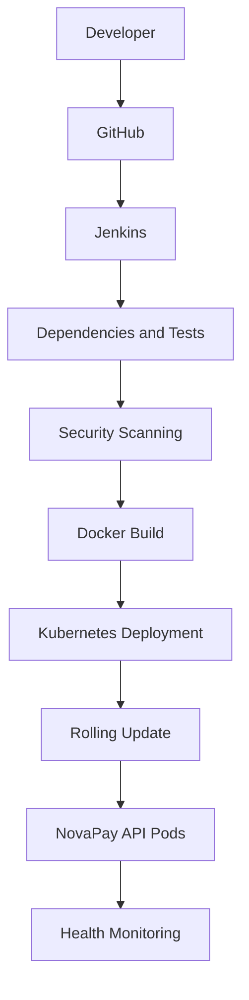

# NovaPay – Zero-Downtime CI/CD Pipeline

A hands-on DevOps project demonstrating automated CI/CD, Docker containerization, Kubernetes orchestration, security scanning, monitoring, rolling updates and rollback.

## Technology Stack

- Node.js and Express
- Docker and Docker Compose
- Jenkins
- Kubernetes and Minikube
- Terraform
- Jest and Supertest
- SonarQube
- OWASP ZAP
- npm audit
- Prometheus and Grafana
- Git and GitHub

## Architecture



## CI/CD Pipeline

1. GitHub source checkout
2. Dependency installation
3. npm audit
4. Automated tests
5. SonarQube analysis
6. Docker image build
7. OWASP ZAP DAST scan
8. Kubernetes deployment integration

## Kubernetes Configuration

- 2 NovaPay API replicas
- RollingUpdate deployment strategy
- Readiness endpoint: `/ready`
- Liveness endpoint: `/health`
- ConfigMap and Secret integration
- NodePort service: `30081`
- CPU and memory requests and limits

## Jenkins RBAC

Dedicated ServiceAccount: `jenkins-deployer`

Role: `novapay-deployer`

RoleBinding: `novapay-deployer-binding`

Jenkins permissions are restricted to the `novapay-api` Deployment.

## Day 15 – Validation Results

| Test | Result |
|---|---|
| Kubernetes deployment | 2/2 Ready |
| Application pods | 2/2 Running |
| Health endpoint | HTTP 200 |
| Rolling update | Successful |
| Rollback | Successful |
| Restored image | `novapay-api:day7` |

The rolling update test changed the image tag from `novapay-api:day7` to `novapay-api:jenkins-test`. Both tags referenced the same image content.

The rollback restored `novapay-api:day7`.

**Note:** A successful rollout does not by itself prove zero downtime. Continuous health-monitor failure counts during the update must be recorded to substantiate that claim.

## Health Monitoring

Run:

```bash
kubectl port-forward service/novapay-service 3000:80
```

In another terminal:

```bash
./scripts/health-check.sh
```

The script checks the `/health` endpoint every second and tracks successful and failed requests.

## Repository Structure

```text
novapay-zero-downtime-cicd/
├── app/
├── kubernetes/
├── terraform/
├── database/
├── monitoring/
├── security/
├── scripts/
├── docs/
├── Jenkinsfile
└── README.md
```

## Project Objective

Demonstrate practical DevOps skills through an end-to-end CI/CD workflow, containerized application deployment, Kubernetes operations, security testing and deployment recovery.
